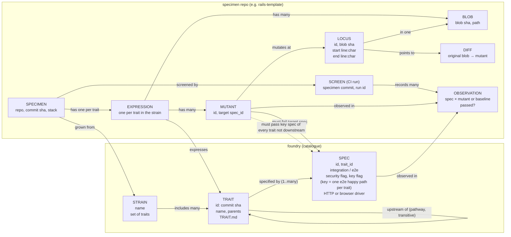

# Context

Domain language for foundry and the specimens grown from it. Status: draft.

The repository still uses the older term **layer** (`layers/`, `LAYER.md`, `register_layer.rb`). A layer is a trait. The rename is not done yet.

## Glossary

| Term | Meaning |
|------|---------|
| **Trait** | A stack-agnostic unit of behaviour, described in `TRAIT.md`. Its id is the foundry commit SHA that introduced it. |
| **Spec** | A tech-agnostic integration or end-to-end test of a trait, driven over HTTP or a browser, with a bias towards security. A trait has many specs. |
| **Key spec** | The one end-to-end happy-path spec of a trait. Mutants of other traits run against it. |
| **Pathway** | The transitive upstream and downstream dependencies between traits. A parent is upstream of its children. |
| **Strain** | A named set of traits in foundry. It includes every trait upstream of its members. |
| **Catalogue** | Foundry: holds traits, specs and strains. |
| **Specimen** | A repository grown from a strain in one stack, for example `rails-template`. Grown one expression at a time, upstream first. Its git history records the growth. |
| **Expression** | One trait as built in a specimen. A specimen has exactly one expression per trait in its strain. An expression has many blobs and many mutants. |
| **Blob** | One file of an expression, identified by git blob SHA and path. |
| **Mutant** | A change to one expression, at one locus, that must fail a target spec. Mutants live in the specimen repository. |
| **Locus** | Where a mutant changes code: one blob of its expression, plus start and end line:char. Points to the diff between the blob and the mutant. |
| **Screen** | One CI run of a specimen commit. Records many observations. Lives in the specimen repository. |
| **Observation** | One spec run under one mutant, or under the unmutated baseline: passed or failed. |
| **Phenotype** | All observations of one mutant. Derived, not stored. |

## Rules

- **Valid spec.** Every spec passes on the baseline, and at least one mutant fails it.
- **Independence.** A mutant of trait A fails its target spec, and passes the key spec of every trait not downstream of A: upstream traits and traits outside A's pathway alike. Only key specs are checked, to keep screens affordable. A mutant that breaks a non-key spec of such a trait can go unnoticed; this trade-off is accepted.
- **Complete strain.** A strain contains every trait upstream of its members.
- **Complete specimen.** A specimen has one expression per trait in its strain, no more and no fewer.
- **Iterative growth.** A specimen is grown, not built in one shot. Each step adds one expression and its mutants, in pathway order, and its screen passes before the next step starts.

## Model

