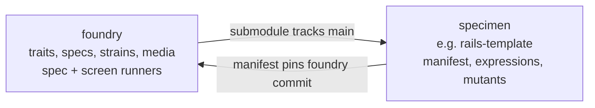
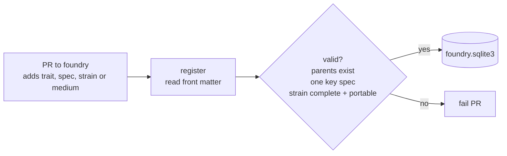
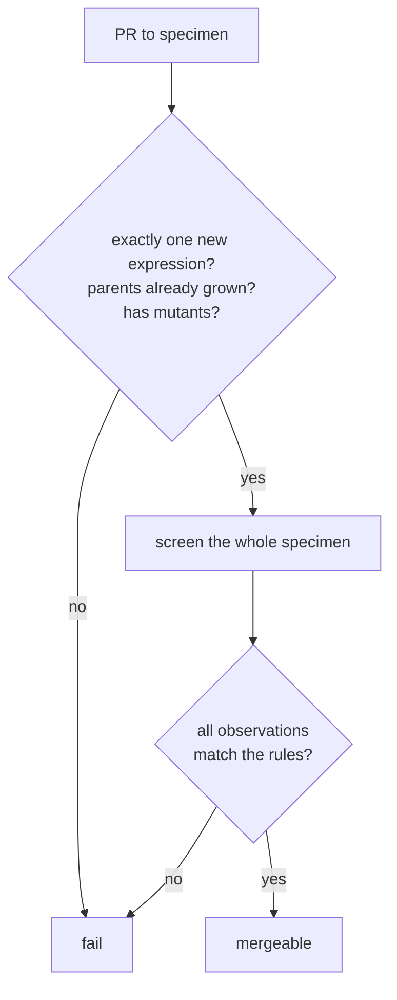
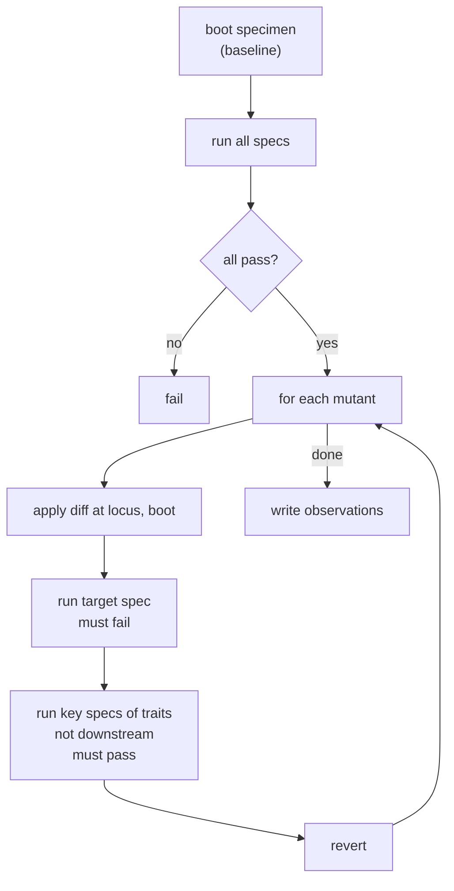

# Critical Path

Status: draft. Terms are defined in [CONTEXT.md](CONTEXT.md).

Goal: a multi-stage growth CI, executed in Ruby, that grows a specimen one expression at a time and screens every step with specs and mutants.

## Milestone: walking skeleton

The smallest thing that proves the model end to end:

- one medium trait (`routing_and_service_architecture`, Ruby on Rails) and one behavioural trait (`session`)
- `session` has a key spec and at least one security spec
- `rails-template` grows both expressions in two steps, with at least two mutants each
- every step's screen passes in CI

## Steps

Steps in order. Each depends on the ones before it unless marked as parallel.

| # | Step | Repo | Done when |
|---|------|------|-----------|
| 1 | **Choose spec technology.** | foundry | A decision is recorded. See [Spec technology](#spec-technology). |
| 2 | **Spec format.** Location (`specs/<trait>/`), metadata: trait, `key`, `security`. One key spec per trait. | foundry | `CONTEXT.md` and `specs/CONTEXT.md` describe it; one example spec exists. |
| 3 | **Specimen contract.** How the spec runner reaches a specimen: a boot command, a base URL, a health check, a reset between runs. | foundry | Documented; `rails-template` implements it. |
| 4 | **Spec runner.** Runs a chosen set of specs against a base URL and writes one observation per spec as JSON. | foundry | Runs the example spec against `rails-template` locally and in CI. |
| 5 | **Catalogue schema.** Add trait kind (behavioural or medium), media, strains and specs to `foundry.sqlite3`; register them from front matter. Parallel with 2–4. | foundry | `register_layer.rb` registers all four; strain completeness and portability are checked at registration. |
| 6 | **Pathway queries.** `upstream(trait)`, `downstream(trait)`, and the key specs a mutant of a trait must pass. | foundry | Callable from the screen runner. |
| 7 | **Specimen manifest.** The specimen declares its strain, its medium, the foundry commit it is pinned to, and for each expression its trait and blobs. | specimen | `rails-template` has a manifest for its existing code. |
| 8 | **Mutant format.** One file per mutant under the expression: id, target spec, locus (blob SHA, path, start and end line:char) and the diff. | specimen | Format documented; a tool checks every locus against its blob. |
| 9 | **Screen runner.** Runs the baseline, then each mutant: apply, boot, run its target spec (must fail) and the key specs of every trait not downstream (must pass), revert. Writes the observations. | foundry | Screens `rails-template` locally; output matches the rules. |
| 10 | **Growth check.** On a specimen PR: exactly one new expression, in pathway order, with mutants; the whole screen passes, so earlier expressions still hold. | specimen | A required CI check on `rails-template`. |
| 11 | **First medium trait.** Grow `routing_and_service_architecture` as step one. Needs an answer to [#12](https://github.com/any-container/foundry/issues/12). | both | Screen passes. |
| 12 | **First behavioural trait.** Write `session` specs, grow its expression and mutants in `rails-template`. | both | Screen passes. The walking skeleton is done. |

Not on the critical path, later:

- Mutant discovery, for example with the [`mutant`](https://github.com/mbj/mutant) gem, proposing candidate mutants for an agent or human to curate.
- Rename layer to trait across foundry.
- Move the drafts workflow from features to traits.
- A second medium (for example Go), to prove the specs are tech-agnostic.
- Screen cost control: caching, parallel boots, screening only changed expressions.

## Spec technology

Specs are black-box: they talk to a running specimen over HTTP or through a browser. That is what makes them tech-agnostic, so the runner itself can be Ruby whatever the specimen's medium.

| Option | What it is | For | Against |
|--------|-----------|-----|---------|
| **RSpec + Capybara + an HTTP client** | Plain RSpec files pointed at a base URL. Capybara with Cuprite or Playwright for the browser, Faraday or similar for HTTP. | Already known. One layer of code. Metadata (`key: true, security: true`) is native. | Specs are Ruby, so less readable as documentation. |
| **Cucumber (Gherkin)** | Plain-language `.feature` files (`Given / When / Then`) plus Ruby step definitions. | Feature files read like the trait description. Tags (`@key`, `@security`) fit the model. Runners exist in other languages (godog, cucumber-js) if foundry ever needs them. | Two layers to maintain: feature text and step glue. Step libraries sprawl. |
| **Hurl** | Plain-text HTTP request and assertion files, run by a CLI. | Very readable for API and auth flows. Good for security checks on headers, cookies, redirects. | No browser. Not Ruby. Limited logic. |
| **Schemathesis or similar** | Property-based fuzzing from an OpenAPI schema. | Strong security bias: finds what hand-written specs miss. | Needs a schema. A supplement, not the spec format. |

Recommendation: RSpec + Capybara for every spec, since it is known and keeps one layer. Choose Cucumber instead if specs should read as documentation for non-Ruby readers. Hurl or Schemathesis can be added later as extra security specs.

## Pipelines

### Repositories

Foundry already holds `rails-template` as a submodule, so the specimen pins a foundry commit in its manifest instead of a second submodule, avoiding a cycle.

### Catalogue registration (foundry)

### Growth step (specimen PR)

### Screen

