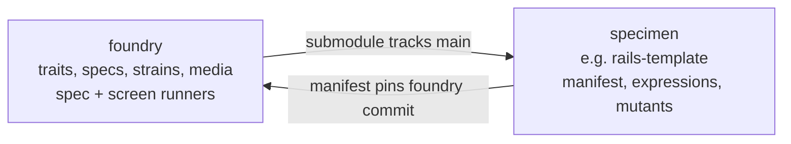
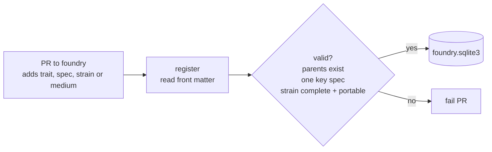
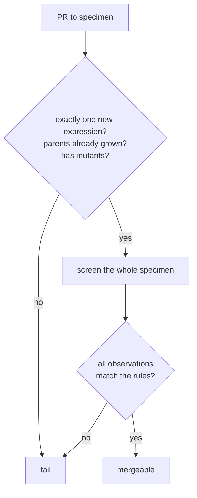
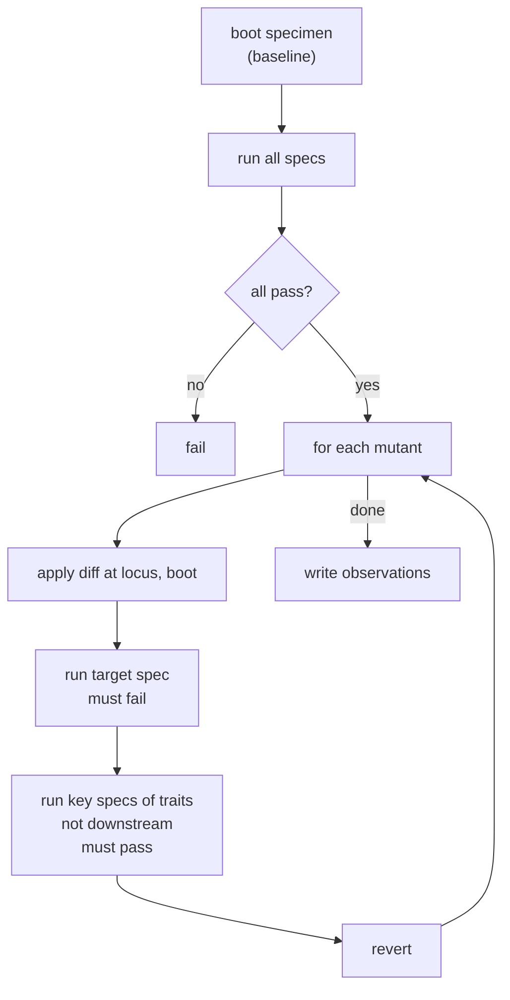

# Critical Path

Status: draft. Terms are defined in [CONTEXT.md](CONTEXT.md).

Goal: a multi-stage growth CI, executed in Ruby, that grows a specimen one expression at a time and screens every step with specs and mutants.

## Stages

Growth is built in two stages. The first trait in each stage is the pilot that builds and documents its part of the pipeline.

1. **Medium stage.** Migrate `routing_and_service_architecture` (Ruby on Rails), currently `layers/routing_and_service_architecture/`, into the first medium trait. That work builds the catalogue schema, specimen manifest, mutant format, screen runner and growth check, and documents each one.
2. **Behavioural stage.** Add `session` as the first behavioural trait. That work adds Cucumber specs, the specimen contract and the spec runner.

The walking skeleton is done when `rails-template` grows both expressions in two screened steps, each with at least two mutants.

## Steps

Steps in order. Each depends on the ones before it unless marked as parallel.

### Medium stage: `routing_and_service_architecture`

| # | Step | Repo | Done when |
|---|------|------|-----------|
| 1 | **Answer [#12](https://github.com/any-container/foundry/issues/12) for this trait.** What its mutants and key spec are. Its existing `spec/architecture/standards_spec.rb` (RSpec, medium-specific) is the starting point; a mutant might remove a `STANDARDS.md` or break an `AGENTS.md` symlink. | foundry | #12 has an answer, at least for this trait. |
| 2 | **Catalogue schema.** Add trait kind (behavioural or medium), media and strains to `foundry.sqlite3`; register them from front matter. Register Ruby on Rails as the first medium and this trait as its first medium trait. | foundry | `register_layer.rb` registers all three; strain completeness and portability are checked at registration. |
| 3 | **Pathway queries.** `upstream(trait)`, `downstream(trait)`, and the key specs a mutant of a trait must pass. | foundry | Callable from the screen runner. |
| 4 | **Specimen manifest.** The specimen declares its strain, its medium, the foundry commit it is pinned to, and for each expression its trait and blobs. | specimen | `rails-template` has a manifest with this trait's expression. |
| 5 | **Mutant format.** One file per mutant under the expression: id, target spec, locus (blob SHA, path, start and end line:char) and the diff. | specimen | Format documented; a tool checks every locus against its blob; this trait has at least two mutants. |
| 6 | **Screen runner.** Runs the baseline, then each mutant: apply, run its target spec (must fail) and the key specs of every trait not downstream (must pass), revert. Writes the observations. | foundry | Screens `rails-template` locally and in CI. |
| 7 | **Growth check.** On a specimen PR: exactly one new expression, in pathway order, with mutants; the whole screen passes. | specimen | A required CI check on `rails-template`. Growing this trait as step one passes it. |
| 8 | **Document the medium stage.** How to add a medium, a medium trait and its mutants. | foundry | A second medium trait could be added from the docs alone. |

### Behavioural stage: `session`

| # | Step | Repo | Done when |
|---|------|------|-----------|
| 9 | **Spec format.** Cucumber `.feature` files in `specs/<trait>/`, tagged `@key` (one per trait) and `@security`. Shared step definitions in Ruby, in foundry. Parallel with 1–8. | foundry | `specs/CONTEXT.md` describes it; one example feature exists. |
| 10 | **Specimen contract.** How the spec runner reaches a specimen: a boot command, a base URL, a health check, a reset between runs. | foundry | Documented; `rails-template` implements it. |
| 11 | **Spec runner.** Runs chosen features against a base URL with Cucumber, Capybara (browser) and an HTTP client, and writes one observation per scenario as JSON. The screen runner uses it, booting the specimen per mutant. | foundry | Runs the example feature against `rails-template` locally and in CI. |
| 12 | **First behavioural trait.** Write `session` features, grow its expression and mutants in `rails-template`. | both | Screen passes. The walking skeleton is done. |

Not on the critical path, later:

- Mutant discovery, for example with the [`mutant`](https://github.com/mbj/mutant) gem, proposing candidate mutants for an agent or human to curate.
- Rename layer to trait across foundry.
- Move the drafts workflow from features to traits.
- A second medium (for example Go), to prove the specs are tech-agnostic.
- Screen cost control: caching, parallel boots, screening only changed expressions.

## Spec technology

Specs are black-box: they talk to a running specimen over HTTP or through a browser. That is what makes them tech-agnostic, so the runner itself can be Ruby whatever the specimen's medium.

| Option | What it is | For | Against |
|--------|-----------|-----|---------|
| **RSpec + Capybara + an HTTP client** | Plain RSpec files pointed at a base URL. Capybara with Cuprite or Playwright for the browser, Faraday or similar for HTTP. | Already known. One layer of code. Metadata (`key: true, security: true`) is native. | Specs are Ruby, so less readable as documentation. |
| **Cucumber (Gherkin)** | Plain-language `.feature` files (`Given / When / Then`) plus Ruby step definitions. | Feature files read like the trait description. Tags (`@key`, `@security`) fit the model. Runners exist in other languages (godog, cucumber-js) if foundry ever needs them. | Two layers to maintain: feature text and step glue. Step libraries sprawl. |
| **Hurl** | Plain-text HTTP request and assertion files, run by a CLI. | Very readable for API and auth flows. Good for security checks on headers, cookies, redirects. | No browser. Not Ruby. Limited logic. |
| **Schemathesis or similar** | Property-based fuzzing from an OpenAPI schema. | Strong security bias: finds what hand-written specs miss. | Needs a schema. A supplement, not the spec format. |

**Decision: Cucumber** for behavioural trait specs, with Ruby step definitions using Capybara and an HTTP client. Feature files double as readable documentation of the trait, and `@key` and `@security` tags carry the spec metadata. Medium traits may use medium-specific specs, such as RSpec in Ruby on Rails (see [#12](https://github.com/any-container/foundry/issues/12)). Hurl or Schemathesis can be added later as extra security specs.

## Pipelines

Four diagrams:

1. [Repositories](#repositories): how foundry and a specimen point at each other.
2. [Catalogue registration](#catalogue-registration-foundry): how traits, specs, strains and media enter foundry.
3. [Growth step](#growth-step-specimen-pr): the check on every specimen PR.
4. [Screen](#screen): baseline, then each mutant against its target spec and key specs.

### Repositories

Foundry already holds `rails-template` as a submodule, so the specimen pins a foundry commit in its manifest instead of a second submodule, avoiding a cycle.

### Catalogue registration (foundry)

### Growth step (specimen PR)

### Screen

